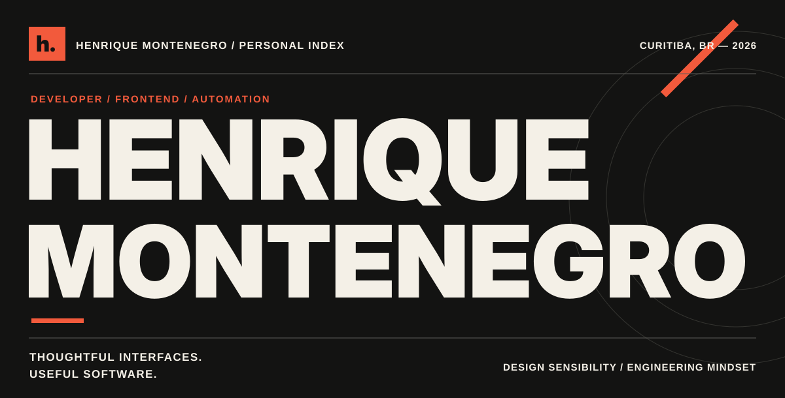
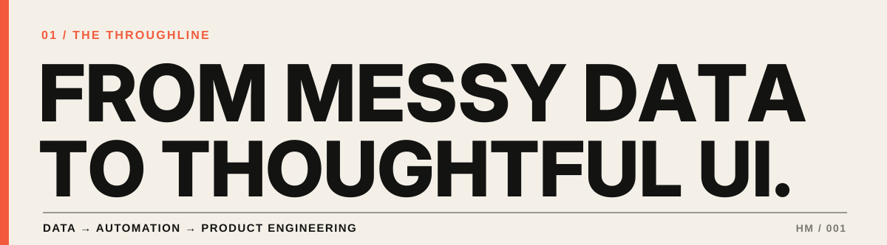
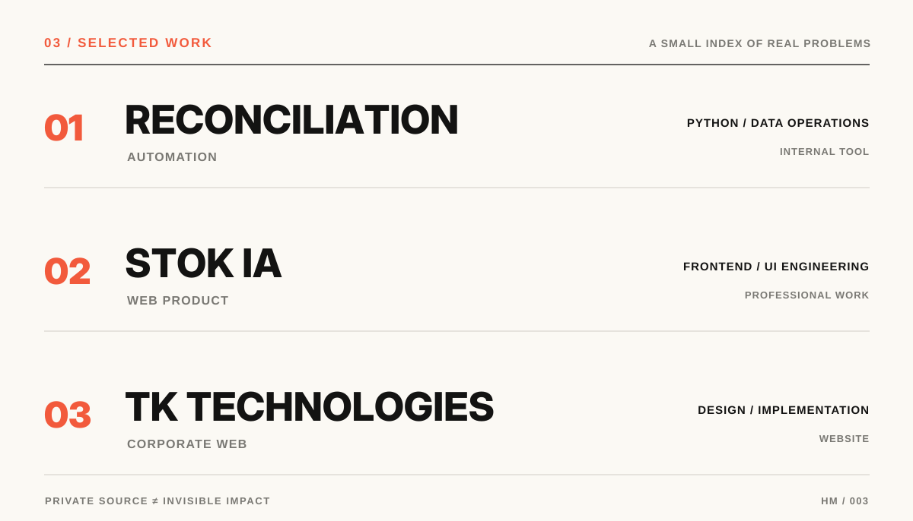
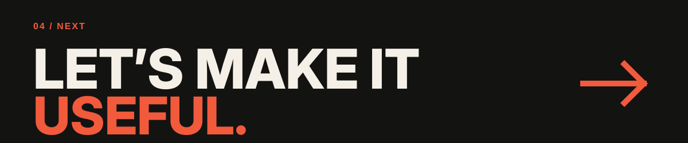

<!--
  HENRIQUE MONTENEGRO / GITHUB PROFILE
  Visual concept: editorial typography, contemporary portfolio, minimal geometry.
  Art direction: off-white / charcoal / vermilion. Assets are original SVGs.
  Before publishing, review the optional LinkedIn URL in the CONTACT section.
  Work experience is summarized at a high level; no private code or metrics are exposed.
-->

  

  <strong>FRONTEND DEVELOPMENT</strong> &nbsp; / &nbsp; <strong>PRODUCT UI</strong> &nbsp; / &nbsp; <strong>PYTHON AUTOMATION</strong>

  Curitiba, Brazil &nbsp;·&nbsp; Building practical software with a strong sense of design.

 

I’m **Henrique**, a software developer working at the intersection of **engineering, interface design, and real-world problem-solving**.

My career began close to the data: reconciliation processes, validation routines, and operational inconsistencies. I helped build a **Python automation tool** that turned a repetitive, manual workflow into a process that could be run by the support team. That experience changed the direction of my career — from analyzing problems to **building the software that solves them**.

Today, my focus is **web product engineering**: translating Figma designs into interfaces, integrating frontends with existing APIs, and helping teams keep implementation aligned with the product experience.

> I care about the details people notice — and the engineering they never have to think about.

 

## 02 / What I bring to the table

| BUILD | CONNECT | IMPROVE |
| :--- | :--- | :--- |
| Web interfaces, responsive UI, JavaScript, HTML & CSS | Figma-to-code workflows, API integration, Git and collaborative delivery | Python automation, data validation, process simplification |

Tools I use: VS Code · Git / GitHub · Figma · Jira · Python · JavaScript

 

**01 — Data reconciliation automation**  
*Python · Data validation · Internal tooling*  
Co-developed a tool to compare datasets, detect discrepancies in amounts and quantities, and assist with identifying matching columns. It made a specialized validation workflow accessible to another team without relying on manual analysis for every run.

**02 — Stok IA / Web product engineering**  
*Frontend · Interface implementation · API integration*  
Working on web interfaces and product flows, bringing Figma designs into the application and connecting them to existing backend capabilities. My work also involves coordinating frontend delivery and keeping design and implementation in sync.

**03 — TK Technologies / Corporate website**  
*Web · Design-to-code · Delivery*  
Work on the visual experience and implementation of the company website. [View website](https://www.tktechnologies.com.br/).

Some of this work lives in private or organization repositories. Descriptions are intentionally high level and do not disclose source code or internal implementation details.

 

## A little more about me

I study **Software Engineering**, enjoy the craft of building polished interfaces, and like exploring where **automation and good UX** make everyday work simpler. I believe a solid product needs more than a nice screen: it needs clarity, maintainability, and a reason to exist.

 

  <strong>GOOD SOFTWARE STARTS WITH A REAL PROBLEM.</strong> 
  Open to exchanging ideas about web products, design systems and automation.

<!-- Optional: replace SEU-USUARIO-LINKEDIN with your real username, then uncomment:

<a href="https://www.linkedin.com/in/SEU-USUARIO-LINKEDIN/">LINKEDIN</a>

-->
