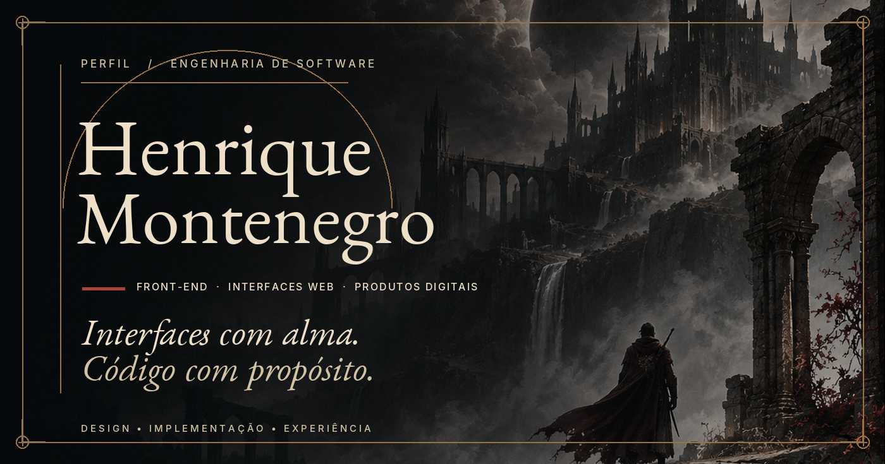
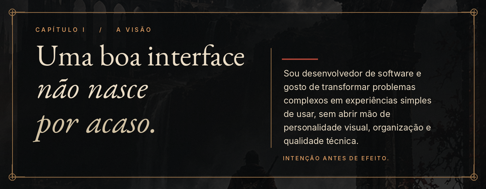
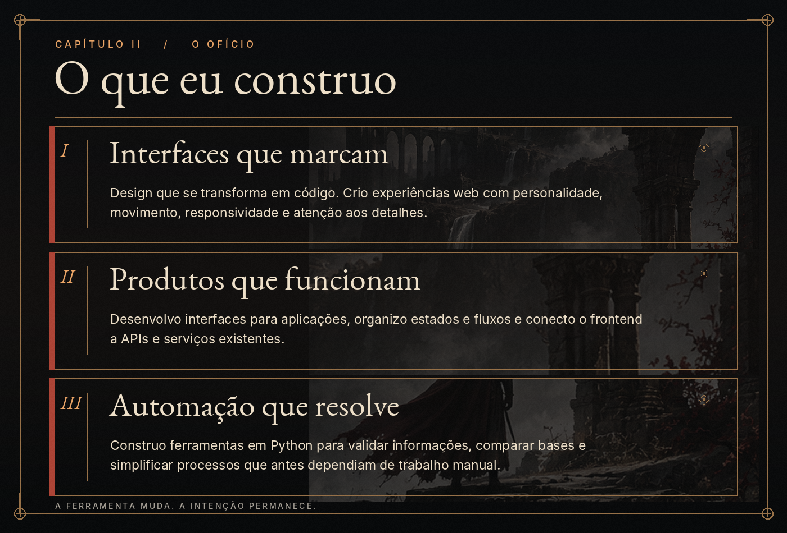
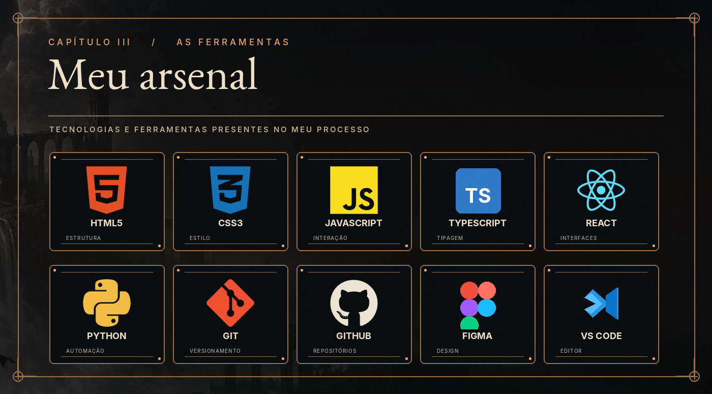
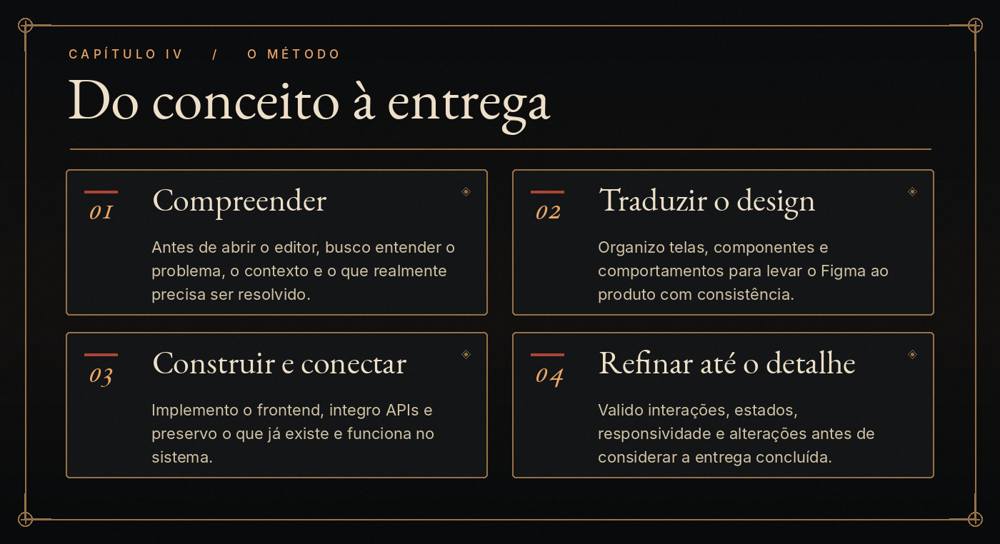
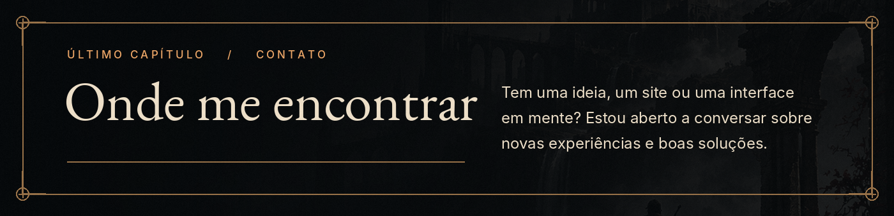
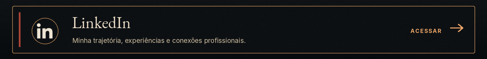
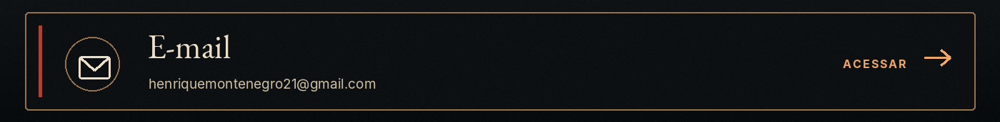

<!--
Perfil GitHub — Henrique Montenegro | Edição dark fantasy v2
Conteúdo em português, sem nomes de empresas ou clientes.
Os elementos gráficos são imagens locais no repositório.
Os dois cards finais são links reais e clicáveis.
-->

  
  
  
  
  
  
  
  
  

📜 Ler o conteúdo em texto e acessar os contatos

# Henrique Montenegro

**Front-end · Interfaces web · Produtos digitais**

*Interfaces com alma. Código com propósito.*

## A visão

Uma boa interface não nasce por acaso.

Sou desenvolvedor de software e gosto de transformar problemas complexos em experiências simples de usar, sem abrir mão de personalidade visual, organização e qualidade técnica. Para mim, intenção vem antes de efeito.

## O que eu construo

**Interfaces que marcam.** Design que se transforma em código. Crio experiências web com personalidade, movimento, responsividade e atenção aos detalhes.

**Produtos que funcionam.** Desenvolvo interfaces para aplicações, organizo estados e fluxos e conecto o front-end a APIs e serviços existentes.

**Automação que resolve.** Construo ferramentas em Python para validar informações, comparar bases e simplificar processos que antes dependiam de trabalho manual.

## Meu arsenal

HTML5 · CSS3 · JavaScript · TypeScript · React · Python · Git · GitHub · Figma · VS Code

## Do conceito à entrega

1. **Compreender:** entender o problema, o contexto e o objetivo.
2. **Traduzir o design:** organizar telas, componentes e comportamentos com consistência.
3. **Construir e conectar:** implementar o front-end, integrar APIs e preservar o que já funciona.
4. **Refinar:** validar interações, estados, responsividade e alterações antes da entrega.

## Vamos conversar?

Sites e interfaces web com identidade, movimento e execução cuidadosa.

**LinkedIn:** https://www.linkedin.com/in/henrique-montenegro-109139251/

**E-mail:** [henriquemontenegro21@gmail.com](mailto:henriquemontenegro21@gmail.com)

**Portifólio:** https://ptleconapantera.github.io/meu_portifolio 

